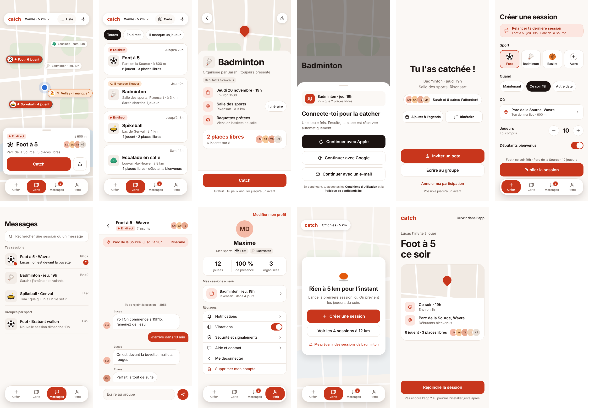

# Catch

Catch fait sortir les gens de chez eux : on ouvre l'app, on voit les sessions de sport autour de soi (foot, badminton, escalade, spikeball…) et on en rejoint une en appuyant sur **Catch**. Pas de niveau à justifier, les débutants sont les bienvenus.

Lancement prévu en Brabant wallon / Bruxelles, d'abord avec un cercle d'amis, puis ville par ville.

## État du projet

Phase de conception terminée (novembre 2026) : idée challengée, parcours, wireframes, design haute fidélité des 11 écrans, système d'animation, audit des textes et pictos des sports. Le code de l'app est dans [mobile/](mobile/) : étapes 0 et 1 du plan faites (projet Expo, barre flottante, thème clair et sombre). Prochaine étape : la carte des sessions.

## Où trouver quoi

| Dossier / lien | Contenu |
| --- | --- |
| [docs/produit.md](docs/produit.md) | Vision, décisions produit, choix techniques, plan de construction |
| [docs/design-system.md](docs/design-system.md) | Couleurs, typo, navigation, composants, animations, vibrations |
| [docs/ux-writing.md](docs/ux-writing.md) | Règles de rédaction, glossaire, textes manquants à écrire |
| [docs/recherches.md](docs/recherches.md) | Résumé des recherches UX et animation qui ont guidé le design |
| [design/apercus/](design/apercus/) | Captures des écrans, des pictos et du système |
| [design/pictos/](design/pictos/) | Les 10 pictos de sport en SVG, prêts pour l'app |
| [design/canvas/](design/canvas/) | Sources du canvas de design et script qui les génère |
| [Canvas de design (claude.ai)](https://claude.ai/artifact/Qda1Ef9NTeL6fSq7kZj8z1) | Design v1 des écrans, modifiable |
| [Canvas wireframes (claude.ai)](https://claude.ai/artifact/Td5KvG3CNRkR7QxivRB6DG) | Plan des écrans, parcours et wireframes d'origine |
| [Audit UX writing (claude.ai)](https://claude.ai/artifact/PZ9qBxvU5qQ3sL4izGLaT4) | Audit complet des 47 textes |
| [Figma — pictos sports](https://www.figma.com/design/CCTgu8sW6XfmQciLAaEUNC) | Pictos d'origine générés avec Figma, en vecteurs |

Les liens claude.ai et Figma sont privés : il faut être connecté au compte de Maxime pour les ouvrir.

